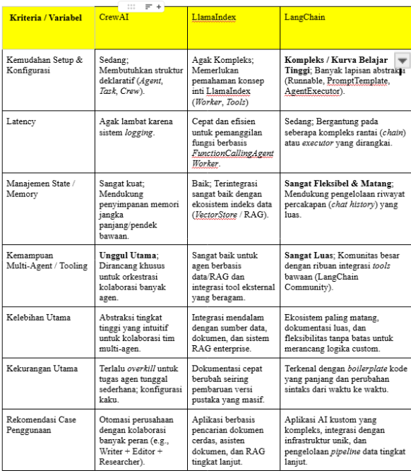
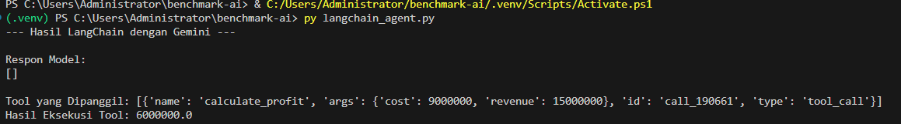
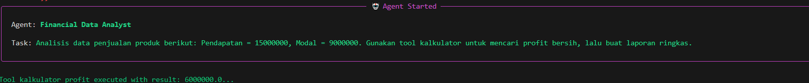

AI Agent Open-Source Benchmarking & Comparison
Repositori ini berisi hasil eksplorasi hands-on dan perbandingan performa dari 4 framework AI Agent open-source populer: CrewAI, LlamaIndex, Agno (Phidata), dan LangChain. Seluruh agen diuji menggunakan skenario tunggal yang identik dan memanfaatkan Google Gemini API (gemini-1.5-flash) sebagai penyedia LLM.

🎯 Skenario Uji Tunggal (Test Case)
Kasus Penggunaan: Agent Analisis Penjualan & Kalkulator Profit Otomatis.

Deskripsi Tugas: Agent menerima data mentah penjualan produk (Pendapatan = Rp15.000.000, Modal = Rp9.000.000), memanggil fungsi kustom (custom tool) berupa kalkulator untuk menghitung total profit bersih secara presisi, lalu menyusun laporan ringkas berbentuk teks profesional.

Konfigurasi Lingkungan: Menggunakan Python venv, pustaka python-dotenv, dan API Key Gemini yang dimuat melalui file .env

